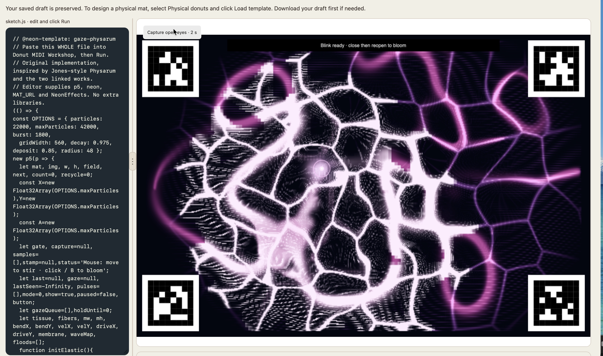

# 100 Days of Eye Tracking

Creative coding with the eyes: an ongoing collection of interactive artworks exploring gaze, blinks, living textures and visual feedback.

[Watch Day 004 — Blink Bloom on YouTube](https://youtu.be/rY8b1xuCErE) · [View all three screenshots](days/004-blink-bloom/#gallery)

## Works

| Day | Work | Interaction | Runtime |
| --- | --- | --- | --- |
| 004 | [Blink Bloom](days/004-blink-bloom/) | Gaze bends an organic network; blinks send bright impulses through it | Donut MIDI Workshop / p5.js |

## Start with Day 004

1. Open the [Donut MIDI Workshop](https://sharkburger.github.io/donut-midi/library/editor.html).
2. Open [the sketch](days/004-blink-bloom/sketch.js), copy its full contents and replace the code in the Workshop Editor.
3. Press **Run**. Move the mouse to stir the network and click to simulate a blink.
4. For live input, connect Pupil Labs Neon using the Workshop's existing connection controls, then capture the two-second open-eye reference.

This repository contains Workshop sketches, not a standalone eye tracker. Each work documents its runtime requirements and verification limits. Series numbers identify entries, not consecutive calendar days.

## Project structure

Each entry lives in `days/NNN-title/`, with its own sketch and description. Entries follow the artist’s 100-day project numbering. This repository currently documents Day 004; other days will be added separately.
