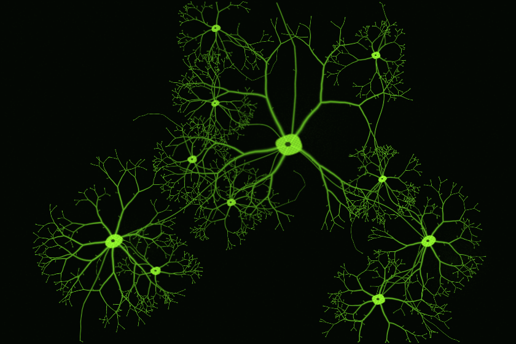

# 100 Days of Eye Tracking

Creative coding with the eyes, built in our **Eye5.js / Donut MIDI Workshop Editor**. Each day has its own code, notes and mouse playground.

## Latest — Day 009: Semantic Spider

**Words become terrain. Meaning becomes movement.**

A glass crawler steps onto actual PDF words. Nouns grow inside pink boxes, prepositions shake in green, and technical concepts erupt in fluorescent pink. A citation such as [2] draws its matching bibliography entry into a long green ribbon connected to the creature's tail.

[Day 009 code, controls and local OpenAI setup](days/009-semantic-spider/) · Local reading works without a key; contextual OpenAI analysis uses your own key through a localhost relay.

## Day 008: PDF Eater

**Your attention feeds the creature. The page remembers.**

Open a PDF and read by scrolling up and down. A pink glass crawler follows your gaze and eats a growing hole when it catches your reading position. Move away to stop; restore the document whenever you like. Your original PDF stays unchanged.

[Day 008 code, controls and process](days/008-pdf-eater/) · Upload a PDF locally; move to guide, hold to feed.

## Day 007: Glass Crawler

**Your gaze leads. The creature follows. Every footstep changes the network.**

A translucent pink ring-body crawler explores breathing black-and-white mycelium. Its eight legs leave green contact ripples and fading branching traces. Catching your gaze sends green light along the legs and releases a network impulse.

[Day 007 code, controls and process](days/007-glass-crawler/) · Move to guide; catch the target to pulse.

## Day 006: Green Neural Touch

Move to seed living trails and temporarily part connections. Click to simulate a blink. No eye tracker is required. Day 006 adds bright green neurons, higher-resolution rendering and a bounded blink-propagation calculation.

[Watch the Day 006 video on YouTube](https://youtu.be/gvRgO1a0wig)

## Day 005 — Golden Colonies

**Gaze seeds. Trails grow. Connections part, then heal.**

Made in our **Eye5.js / Donut MIDI Workshop Editor**, Golden Colonies turns gaze into living particle strokes beneath a golden, Physarum-inspired landscape. Uneven colonies slowly expand and contract. Moving your eyes temporarily parts their connections; looking away lets them heal. A blink sends a luminous impulse through the network.

[Watch the Day 005 video on YouTube](https://youtu.be/qlUA3l-EwDk)

[Explore Day 005: code, controls and process](days/005-golden-colonies/) · Move your mouse to simulate gaze; click to simulate a blink.

## Daily index

| Day | Work | Code and notes | Mouse playground |
| --- | --- | --- | --- |
| 004 | Blink Bloom | [Open Day 004](days/004-blink-bloom/) | [Play](https://dolbywu.github.io/100-days-of-eye-tracking/days/004-blink-bloom/demo/) |
| 005 | Golden Colonies | [Open Day 005](days/005-golden-colonies/) | [Play](https://dolbywu.github.io/100-days-of-eye-tracking/days/005-golden-colonies/demo/) |
| 006 | Green Neural Touch | [Open Day 006](days/006-green-neural-touch/) | [Play](https://dolbywu.github.io/100-days-of-eye-tracking/days/006-green-neural-touch/demo/) |
| 007 | Glass Crawler | [Open Day 007](days/007-glass-crawler/) | [Play](https://dolbywu.github.io/100-days-of-eye-tracking/days/007-glass-crawler/demo/) |
| 008 | PDF Eater | [Open Day 008](days/008-pdf-eater/) | [Play](https://dolbywu.github.io/100-days-of-eye-tracking/days/008-pdf-eater/demo/) |
| 009 | Semantic Spider | [Open Day 009](days/009-semantic-spider/) | [Play](https://dolbywu.github.io/100-days-of-eye-tracking/days/009-semantic-spider/demo/) |

Each entry is stored in `days/NNN-title/`, with a `README.md`, a paste-ready `sketch.js`, and a `demo/index.html`. Entries retain their project day numbers; days not yet documented here are omitted rather than renumbered.

## Run with eye tracking

1. Open [our Eye5.js / Donut MIDI Workshop Editor](https://sharkburger.github.io/donut-midi/library/editor.html).
2. Copy a day's complete `sketch.js`, replace the editor code and press **Run**.
3. Explore with the mouse first, or connect Pupil Labs Neon using the existing input controls.
4. For live blinks, capture a two-second open-eye reference. See each day's requirements and controls.

The mouse playgrounds run directly in the browser. Live eye tracking requires the Workshop and its local Neon connector. Device and visual-verification limits are documented per work.

## Day 004 video and gallery

[Watch on YouTube](https://youtu.be/rY8b1xuCErE) · [View the screenshots](days/004-blink-bloom/#gallery)
