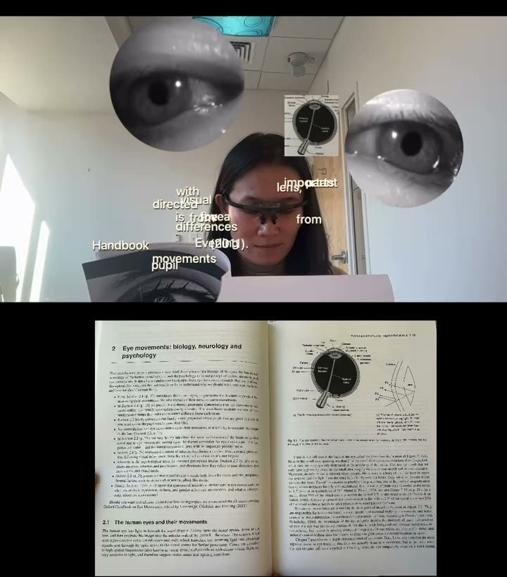
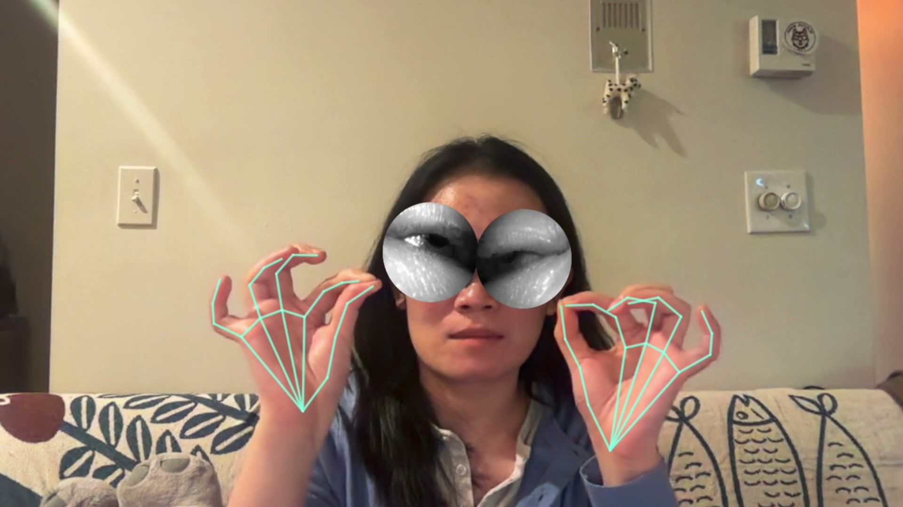
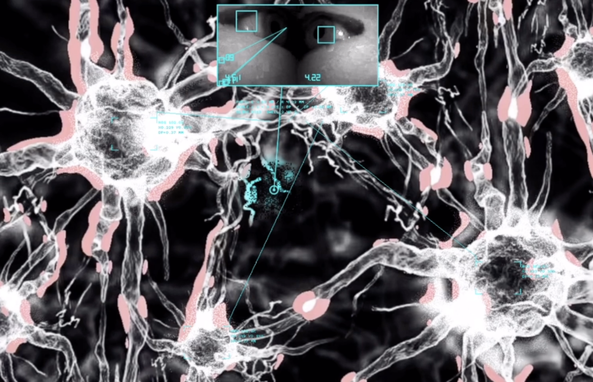
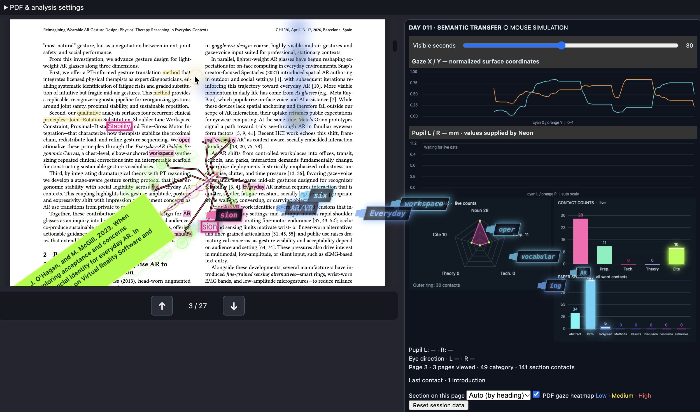
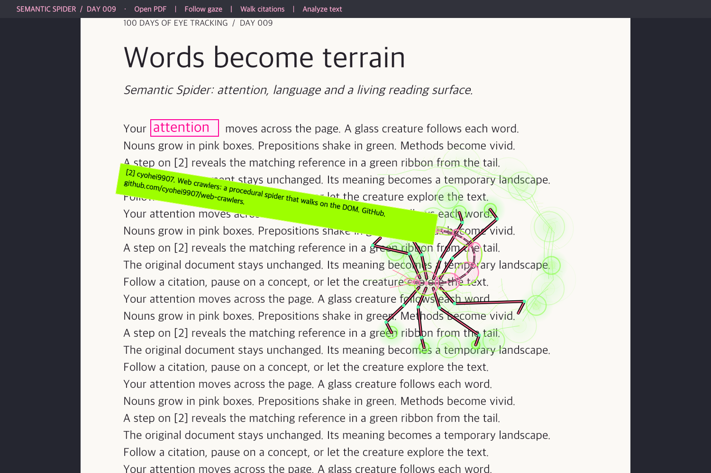
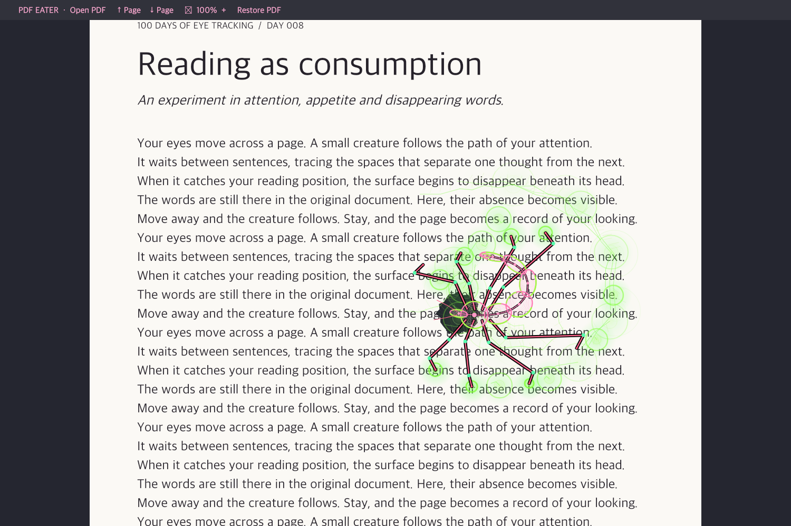

# 100 Days of Eye Tracking

Creative coding with the eyes. Earlier entries use the **Eye5.js / Donut MIDI Workshop Editor**. Starting with Day 012, the project also connects **Pupil Labs Neon** to **TouchDesigner** for live audiovisual and gesture experiments.

## Daily index

| Day | Work | Code and notes | Try it |
| --- | --- | --- | --- |
| 004 | Blink Bloom | [Open Day 004](days/004-blink-bloom/) | [Play](https://dolbywu.github.io/100-days-of-eye-tracking/days/004-blink-bloom/demo/) |
| 005 | Golden Colonies | [Open Day 005](days/005-golden-colonies/) | [Play](https://dolbywu.github.io/100-days-of-eye-tracking/days/005-golden-colonies/demo/) |
| 006 | Green Neural Touch | [Open Day 006](days/006-green-neural-touch/) | [Play](https://dolbywu.github.io/100-days-of-eye-tracking/days/006-green-neural-touch/demo/) |
| 007 | Glass Crawler | [Open Day 007](days/007-glass-crawler/) | [Play](https://dolbywu.github.io/100-days-of-eye-tracking/days/007-glass-crawler/demo/) |
| 008 | PDF Eater | [Open Day 008](days/008-pdf-eater/) | [Play](https://dolbywu.github.io/100-days-of-eye-tracking/days/008-pdf-eater/demo/) |
| 009 | Semantic Spider | [Open Day 009](days/009-semantic-spider/) | [Play](https://dolbywu.github.io/100-days-of-eye-tracking/days/009-semantic-spider/demo/) |
| 010 | Reading Observatory | [Open Day 010](days/010-reading-observatory/) | [Play](https://dolbywu.github.io/100-days-of-eye-tracking/days/010-reading-observatory/demo/) |
| 011 | Semantic Transfer | [Open Day 011](days/011-semantic-transfer/) | [Play](https://dolbywu.github.io/100-days-of-eye-tracking/days/011-semantic-transfer/demo/) |
| 012 | Neural Signals · Gaze Fluid | [Open Day 012](days/012-gaze-fluid/) | [TouchDesigner demo](days/012-gaze-fluid/#try-without-neon) |
| 013 | Eye Bounce | [Open Day 013](days/013-eye-bounce/) | [Mac setup](days/013-eye-bounce/#run-on-a-mac) |
| 014 | Reading Orbits | [Open Day 014](days/014-reading-orbits/) | [TouchDesigner project](days/014-reading-orbits/Day14-Reading-Orbits-Dashboard.toe) |
| 015 | Interactive Eye Circles | [Open Day 015](days/015-eye-flow/) | [Fire preview](days/015-eye-flow/media/fire-ring.mp4) |

Each entry is stored in `days/NNN-title/`. Eye5.js entries include a paste-ready sketch and mouse demo. Day 012 includes a TouchDesigner build script and simulated gaze. Entries retain their project day numbers; days not yet documented here are omitted rather than renumbered.

## Latest — Day 015 · Interactive Eye Circles

Pinch to move and resize two live Neon eyes over the Mac camera. Triple blinks cycle fire, blue water ripples and a calligraphic clock, while a dashboard displays live eye and head-motion data. [Open Day 015](days/015-eye-flow/)

## Day 014 · Reading Orbits

A live Mac camera portrait becomes a reading stage. Neon eye video floats above the reader, and recognized words emerge from the eyes as the page is read. The dashboard shows the incoming eye data.

[Day 014 project and setup](days/014-reading-orbits/)

## Day 013 · Eye Bounce

Two circular crops of the Neon eye video move with your gaze over a live camera portrait. Open your hand to bounce an eye off a finger. Pinch to drag it and feel a slight elastic stretch. When you let go, the eye pauses and your gaze takes over.

[Watch the Day 013 video on YouTube](https://youtu.be/CoOWgR-9OOE) · [Day 013 project and Mac setup](days/013-eye-bounce/)

## Day 012: Neural Signals · Gaze Fluid

Look to light up a neural image in cyan. Blink to send a white pulse. Blink three times to scatter it into a textured point cloud, then close both eyes for three seconds to bring it back. Each gesture has its own synthesized sound. The work takes inspiration from sensory transduction and research on neural signalling in autism.

[Watch the Day 012 video on YouTube](https://youtu.be/H5AxhrK5gwA) · [Day 012 project, connection guide and research notes](days/012-gaze-fluid/) · [Listen to the sound demo](days/012-gaze-fluid/media/day12-sound.wav)

## Day 011: Semantic Transfer

A glass crawler turns PDF reading into a song. Words fly from the page into a live dashboard, citations ring out in an ascending chime, and section changes shift the harmony.

[Try with mouse](https://dolbywu.github.io/100-days-of-eye-tracking/days/011-semantic-transfer/demo/) · [Day 011 code and setup](days/011-semantic-transfer/) · [Watch the Day 011 Short on YouTube](https://youtube.com/shorts/OEPCC99ibe0)

## Day 010: Reading Observatory

A glass crawler follows your gaze across a PDF while a live dashboard charts where you look and what the creature touches. Read with a per-page heatmap, watch gaze and pupil traces, and see word and citation contacts accumulate in the radar and bar charts.

[Try with mouse](https://dolbywu.github.io/100-days-of-eye-tracking/days/010-reading-observatory/demo/) · [Day 010 code and Neon setup](days/010-reading-observatory/) · [Watch the Day 010 Short on YouTube](https://www.youtube.com/shorts/KJUBxSQt9Os)

## Day 009: Semantic Spider

**Words become terrain. Meaning becomes movement.**

A glass crawler steps onto actual PDF words. Nouns grow inside pink boxes, prepositions shake in green, and technical concepts erupt in fluorescent pink. A citation such as [2] draws its matching bibliography entry into a long green ribbon connected to the creature's tail.

[Watch the Day 009 video on YouTube](https://youtu.be/7BN3-eKv-7M)

[Day 009 code, controls and local OpenAI setup](days/009-semantic-spider/) · Local reading works without a key; contextual OpenAI analysis uses your own key through a localhost relay.

## Day 008: PDF Eater

**Your attention feeds the creature. The page remembers.**

Open a PDF and read by scrolling up and down. A pink glass crawler follows your gaze and eats a growing hole when it catches your reading position. Move away to stop; restore the document whenever you like. Your original PDF stays unchanged.

[Watch the Day 008 video on YouTube](https://www.youtube.com/watch?v=nGaAd_f6uzQ)

[Day 008 code, controls and process](days/008-pdf-eater/) · Upload a PDF locally; move to guide, hold to feed.

## Day 007: Glass Crawler

**Your gaze leads. The creature follows. Every footstep changes the network.**

A translucent pink ring-body crawler explores breathing black-and-white mycelium. Its eight legs leave green contact ripples and fading branching traces. Catching your gaze sends green light along the legs and releases a network impulse.

[Watch the Day 007 video on YouTube](https://youtu.be/L-U_Fgt3GtQ)

[Day 007 code, controls and process](days/007-glass-crawler/) · Move to guide; catch the target to pulse.

## Day 006: Green Neural Touch

Move to seed living trails and temporarily part connections. Click to simulate a blink. No eye tracker is required. Day 006 adds bright green neurons, higher-resolution rendering and a bounded blink-propagation calculation.

[Watch the Day 006 video on YouTube](https://youtu.be/gvRgO1a0wig)

## Day 005 — Golden Colonies

**Gaze seeds. Trails grow. Connections part, then heal.**

Made in our **Eye5.js / Donut MIDI Workshop Editor**, Golden Colonies turns gaze into living particle strokes beneath a golden, Physarum-inspired landscape. Uneven colonies slowly expand and contract. Moving your eyes temporarily parts their connections; looking away lets them heal. A blink sends a luminous impulse through the network.

[Watch the Day 005 video on YouTube](https://youtu.be/qlUA3l-EwDk)

[Explore Day 005: code, controls and process](days/005-golden-colonies/) · Move your mouse to simulate gaze; click to simulate a blink.

## Run with eye tracking

1. Open [our Eye5.js / Donut MIDI Workshop Editor](https://sharkburger.github.io/donut-midi/library/editor.html).
2. Copy a day's complete `sketch.js`, replace the editor code and press **Run**.
3. Explore with the mouse first, or connect Pupil Labs Neon using the existing input controls.
4. For live blinks, capture a two-second open-eye reference. See each day's requirements and controls.

The mouse playgrounds run directly in the browser. Live eye tracking requires the Workshop and its local Neon connector. Device and visual-verification limits are documented per work.

## Day 004 video and gallery

[Watch on YouTube](https://youtu.be/rY8b1xuCErE) · [View the screenshots](days/004-blink-bloom/#gallery)
