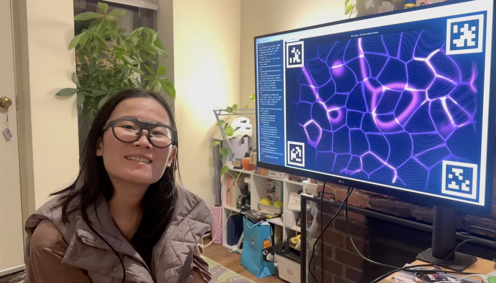

# 100 Days of Eye Tracking

Creative coding with the eyes, built in our **Eye5.js / Donut MIDI Workshop Editor**. Each day has its own code, notes and mouse playground.

## Latest — Day 006: Green Neural Touch

Move to seed living trails and temporarily part connections. Click to simulate a blink. No eye tracker is required. Day 006 adds bright green neurons, higher-resolution rendering and a bounded blink-propagation calculation.

## Daily index

| Day | Work | Code and notes | Mouse playground |
| --- | --- | --- | --- |
| 004 | Blink Bloom | [Open Day 004](days/004-blink-bloom/) | [Play](https://dolbywu.github.io/100-days-of-eye-tracking/days/004-blink-bloom/demo/) |
| 005 | Golden Colonies | [Open Day 005](days/005-golden-colonies/) | [Play](https://dolbywu.github.io/100-days-of-eye-tracking/days/005-golden-colonies/demo/) |
| 006 | Green Neural Touch | [Open Day 006](days/006-green-neural-touch/) | [Play](https://dolbywu.github.io/100-days-of-eye-tracking/days/006-green-neural-touch/demo/) |

Each entry is stored in `days/NNN-title/`, with a `README.md`, a paste-ready `sketch.js`, and a `demo/index.html`. Entries retain their project day numbers; days not yet documented here are omitted rather than renumbered.

## Run with eye tracking

1. Open [our Eye5.js / Donut MIDI Workshop Editor](https://sharkburger.github.io/donut-midi/library/editor.html).
2. Copy a day's complete `sketch.js`, replace the editor code and press **Run**.
3. Explore with the mouse first, or connect Pupil Labs Neon using the existing input controls.
4. For live blinks, capture a two-second open-eye reference. See each day's requirements and controls.

The mouse playgrounds run directly in the browser. Live eye tracking requires the Workshop and its local Neon connector. Device and visual-verification limits are documented per work.

## Day 004 video and gallery

[Watch on YouTube](https://youtu.be/rY8b1xuCErE) · [View the screenshots](days/004-blink-bloom/#gallery)
