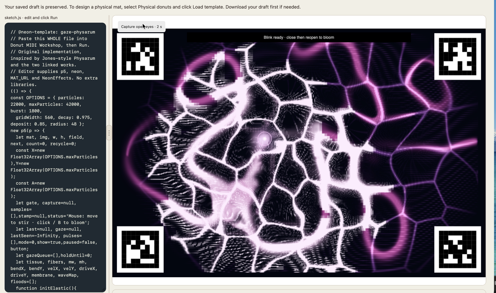
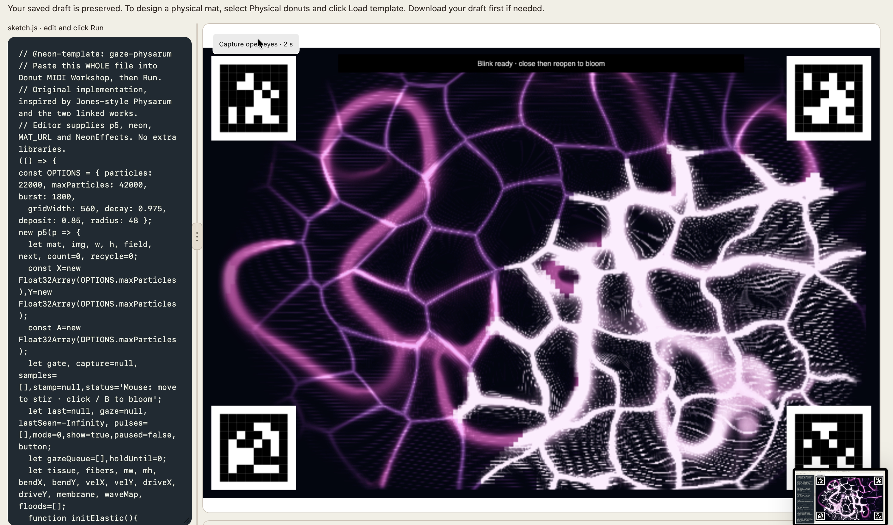
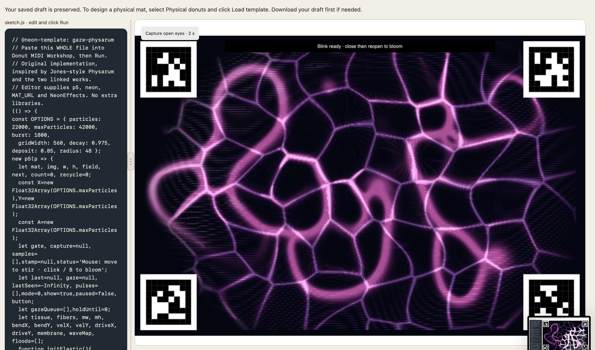

# Day 001 — Blink Bloom

**Creative coding × eye tracking**

A living violet and magenta membrane on a deep blue-black field. Gaze pulls and bends its porous filaments; a blink launches a bright pink-white impulse that travels outward through the network.

凝视推开网状组织，眨眼让粉白色脉冲沿网络向四周蔓延。

## Gallery

Screenshots supplied by the artist, captured in Donut MIDI Workshop.

## Run

Copy all of [sketch.js](sketch.js) into the current [Donut MIDI Workshop Editor](https://sharkburger.github.io/donut-midi/library/editor.html), replacing the previous sketch, and press **Run**. Paste JavaScript only, without Markdown fences or HTML tags.

The Workshop supplies `p5`, `neon`, `MAT_URL` and `NeonEffects`. Use a current Workshop build containing `NeonEffects.read` and `NeonEffects.BlinkGate`. This file is not an HTML page or a standalone Node program.

### Mouse exploration

- Move: deform the network and influence the particle flow.
- Click or **B**: launch a bloom at the pointer position.
- **1 / 2 / 3**: change particle growth behavior.
- **G**: toggle the gaze halo.
- **R**: regenerate the network.
- **Space**: pause or resume the simulation.

### Live eye tracking

Connect Neon through the Workshop's connection controls and local connector. Click **Capture open eyes · 2 s**, keeping both eyes naturally open for two seconds. Once **Blink ready** appears, close and reopen the eyes to trigger a bloom.

Live blink interaction requires fresh bilateral eyelid-aperture data. If the interface reports **No eyelid data**, check the Companion / connector configuration. Missing gaze samples are not treated as blinks. Mouse click and B simulation are disabled during live input.

A 100 ms gaze buffer discards samples near eyelid closure. The cursor holds its last accepted position during closure and for approximately 180 ms after reopening. BlinkGate is the Workshop's experimental closure/reopening detector, not the official Pupil Labs blink detector.

Running the sketch again recreates the preview; reconnect and recapture the eye reference as needed.

## How it works

- Particles steer using three forward sensors, deposit a trail, and follow its diffusion and decay.
- A warped cellular scaffold supplies connected pores and fine contour-like filaments.
- A damped spring displacement field bends the scaffold under gaze, then lets it relax.
- On a blink, weighted shortest paths are computed over a coarse grid. Impulses travel faster along membrane regions and more slowly across pores. This is an artistic propagation model rather than a reconstruction of biological neurons.
- Pulse light blends toward near-white independently of the darker ambient magenta palette.
- Original Workshop marker patterns and positions are preserved in four corner patches.

The scaffold is procedurally generated, elastically deformed and animated; its topology does not biologically grow or rewire. The particle field continuously evolves. The implementation uses CPU arrays and p5 image rendering, not the GPU implementations of the reference projects.

## Performance and verification

Default: 22,000 particles, up to 42,000, and a 560-pixel simulation width. For slower machines, reduce `particles` to 12000, `maxParticles` to 24000 and `gridWidth` to 320 near the top of the sketch. Press R to rebuild after changing code and running again.

JavaScript syntax was checked. Automated checks with a simulated p5 host exercised particle updates, spawning, resizing, parameter changes, membrane displacement, finite shortest paths to every coarse grid node and delayed propagation. The actual Workshop BlinkGate was used to test closure/reopening, stale input rejection and a synthetic downward gaze artifact. Reduced-resolution checks exercised the latest lighting version. These checks do not replace browser visual QA or hardware testing; Neon performance, eye-state availability and real-device detection remain device-dependent.

## Inspiration and runtime credits

- [Bewelge / Physarum-WebGL](https://github.com/Bewelge/Physarum-WebGL): particle-trail systems and pointer interaction.
- [Bleuje / interactive-physarum](https://github.com/Bleuje/interactive-physarum): organic network structures, local interaction and luminous visual references.
- [Donut MIDI](https://github.com/sharkburger/donut-midi/tree/aoi-cognitive-voices): Workshop runtime, p5 Neon integration, calibration and experimental BlinkGate.
- [p5.js](https://p5js.org/): creative coding runtime.

This is an independently written Workshop sketch inspired by those works, not a port or redistribution of their shader code. Runtime dependencies are supplied by Donut MIDI and are not bundled here.
