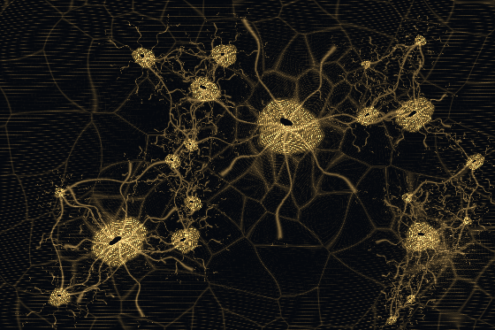

# Day 005 — Golden Colonies

**100 Days of Eye Tracking · Creative coding in our Eye5.js / Donut MIDI Workshop Editor**

**Gaze seeds. Trails grow. Connections part, then heal.**

Uneven golden colonies slowly expand and contract, surrounded by winding filaments. Looking across the artwork seeds a stream of living particles underneath the tissue while temporarily opening gaps in its connections. Moving away lets those gaps heal. A blink sends a bright impulse outward through the network.

This entry preserves the golden colony version, including its blink-freeze fix. It is separate from the experimental neuron-arbor version.

*Cover generated from this entry's sketch renderer; not an eye-tracker recording.*

## Video

[Watch Day 005 — Golden Colonies on YouTube](https://youtu.be/qlUA3l-EwDk)

Created in our Eye5.js / Donut MIDI Workshop Editor: gaze seeds living trails, connections part and heal, and blinks send luminous impulses through the network.

## Try with a mouse

Move to seed particle trails and part the foreground connections. Click to simulate a blink. No eye tracker or installation is required for the mouse playground.

## Run in our editor

1. Open [our Eye5.js / Donut MIDI Workshop Editor](https://sharkburger.github.io/donut-midi/library/editor.html).
2. Copy the full contents of [sketch.js](sketch.js), replace the editor code, and press **Run**.
3. Explore with the mouse first, or connect live Pupil Labs Neon through the editor's existing connection controls.
4. For live blinks, click **Capture open eyes · 2 s** and keep both eyes naturally open for two seconds. Once **Blink ready** appears, close and reopen the eyes to pulse.

The editor supplies `p5`, `neon`, `MAT_URL` and the current `NeonEffects` helpers. Do not add duplicate setup declarations when pasting into the editor. Live input requires the existing Neon connector and fresh bilateral eyelid-aperture samples. Missing samples are not interpreted as blinks. Reconnect and recapture the open-eye reference after restarting the preview when needed.

| Input | Result |
| --- | --- |
| Gaze / mouse movement | Seed particle strokes, deform tissue, and temporarily part foreground connections |
| Blink / mouse click / B | Launch a bright network impulse; mouse simulation is disabled during live input |
| Move away | Repair begins after about 650 ms and restores the tissue over about 1.9 seconds |
| R | Regenerate the arrangement |
| G | Toggle the gaze halo |
| 1 / 2 / 3 | Change sensor and movement presets |
| Space | Pause / resume simulation |

## Algorithms and implementation

### 1. Physarum-inspired particle feedback

The particle layer is inspired by Jeff Jones's multi-agent Physarum model. Each agent senses a trail field ahead, ahead-left and ahead-right, turns in response to the samples, moves, and deposits material. Local diffusion and evaporation feed those deposits back into subsequent motion. The implementation is an artistic adaptation, not a complete reproduction of the paper's model.

| Parameter | Meaning | Default preset |
| --- | --- | --- |
| Sensor Angle (SA) | Offset of side sensors from the heading | 0.58 radians |
| Rotation Angle (RA) | Steering increment | 0.34 radians per simulation step |
| Sensor Offset (SO) | Forward sensing distance | 9 simulation pixels |
| Step Size / speed (SS) | Movement distance | 1.05 simulation pixels per step |

The remaining two presets are `[16, 0.8, 0.55, 1.25]` and `[6, 0.42, 0.26, 0.8]`, in SO / SA / RA / SS order. Motion and evaporation are adjusted by a bounded frame-time factor. These are visual parameters rather than biological measurements.

### 2. Gaze as a particle brush

Inspired by nicoptere's drag-to-draw interaction, the sketch interpolates along successive accepted gaze positions and inserts a narrow stream of agents. These agents continue sensing, steering and depositing trails after gaze leaves. Stationary gaze does not continuously reseed the same point; large jumps and missing input break the stroke instead of drawing across the entire canvas.

Brush agents have a finite lifetime and use a separate trail field with diffusion and decay. This field is composited **under** the golden tissue, so intact colonies remain in the foreground and cut areas reveal the particle strokes below.

### 3. Uneven colonies and filament texture

The visible background is a hybrid procedural scaffold and evolving particle field. Nonuniformly spaced sites form warped cellular pores. Asymmetric colony placement, unequal radii, nested contours and crossing filaments create dense regions next to larger open chambers. The colony interiors use layered winding strands rather than regular flower lobes.

A low-resolution displacement field gives each colony a different slow expansion/contraction rhythm. This changes apparent geometry and pulls nearby fibers; it does not create new biological cells or rebuild network topology. The topology of the scaffold remains generated at reset.

### 4. Deformation, temporary disconnection and healing

A damped spring field deforms the tissue near moving gaze, then relaxes it. A separate lesion field suppresses tissue and clears local trail memory along the gaze path. After gaze leaves, a smooth timed recovery restores the visual connection. Bilinear sampling of the lesion field reduces block-shaped edges.

This is an artistic disconnection-and-repair effect, not a simulation of neural injury or actual synapse regeneration.

### 5. Blink propagation and the freeze fix

Blinks use the editor's experimental `BlinkGate`, calibrated to an individual open-eye aperture reference. A 100 ms gaze buffer rejects samples near closure; a short hold of approximately 180 ms after reopening reduces blink-related cursor drift.

Each blink launches weighted shortest-path propagation over a coarse grid. Travel is faster along membrane regions and slower across open space. Arrival times drive the bright pulse, particle stimulation and a small local deformation.

The freeze fix is important for bright, dense colonies:

- Membrane density is **clamped to [0, 1] before computing path costs**. Unbounded visual density could previously produce negative edge costs, allowing the path search to relax the same loop indefinitely.
- At most **384 heap entries** are processed in a draw frame, rather than completing the full search synchronously.
- At most two pulse records are retained, with a 450 ms trigger cooldown.
- Blink bursts redistribute existing particles instead of increasing the permanent simulation load.

This is a visual network impulse, not an electrophysiological action-potential model. BlinkGate is the Workshop's experimental closure/reopening detector, not Pupil Labs' official blink detector.

## Runtime and performance

This is a CPU-array and p5 image-rendering implementation. It does not run the reference projects' WebGL or compute shaders. Defaults are 22,000 background particles, a 560-pixel-wide simulation and a bounded 6,000-agent drawing pool. On slower devices, reduce `particles` to 12000 and `gridWidth` to 320 in `OPTIONS` and run again.

The standalone playground reuses the unmodified runtime files already bundled for [Day 004](../004-blink-bloom/demo/THIRD_PARTY_NOTICES.md). Corner marker artwork is retained from the editor; the sketch does not replace or redraw the tag patterns.

## Validation and limits

The exact published sketch passes JavaScript syntax checks. Automated simulated-host checks cover spawning, particle strokes continuing after gaze leaves, deformation, timed healing, layering, smooth cut edges and autonomous size changes. Full-resolution stress tests complete repeated blink path searches, including deliberately excessive membrane density, with bounded work per frame. Repeated bursts keep particle counts bounded and subsequent draw calls complete.

This is not a claim of hardware validation. Physical Neon detection accuracy, real-browser frame rate and display appearance still depend on the device and editor version.

## References and credits

1. **Jeff Jones (2010).** *Characteristics of Pattern Formation and Evolution in Approximations of Physarum Transport Networks.* Artificial Life, 16(2), 127–153. [DOI: 10.1162/artl.2010.16.2.16202](https://doi.org/10.1162/artl.2010.16.2.16202) · [Author's institutional record](https://uwe-repository.worktribe.com/output/980579/characteristics-of-pattern-formation-and-evolution-in-approximations-of-physarum-transport-networks). Foundation for sensing / steering / deposition / diffusion feedback.
2. **nicoptere / physarum.** [Repository](https://github.com/nicoptere/physarum) · [Controls.js](https://github.com/nicoptere/physarum/blob/master/src/Controls.js). Reference for drawing a particle stream along pointer movement and exposing SA, RA, SO and SS parameters.
3. **Bleuje / interactive-physarum.** [Repository](https://github.com/Bleuje/interactive-physarum). Visual and interaction inspiration for dense organic structures, localized control and propagating disturbances.
4. **Bewelge / Physarum-WebGL.** [Repository](https://github.com/Bewelge/Physarum-WebGL). Reference for particle-trail feedback and interactive particle manipulation.
5. **Our Eye5.js / Donut MIDI Workshop.** [Runtime source](https://github.com/sharkburger/donut-midi/tree/aoi-cognitive-voices/library). Editor, Neon integration and blink-calibration helpers.
6. **p5.js.** [Project](https://p5js.org/). Creative-coding runtime.

The artwork code is independently implemented. Reference artwork images and third-party shader code are not embedded in this entry. Neuro-Forge and the Gabrielle Kardzhilova neuron reference belong to the separate neuron-arbor experiment, not this selected golden-colony version.
