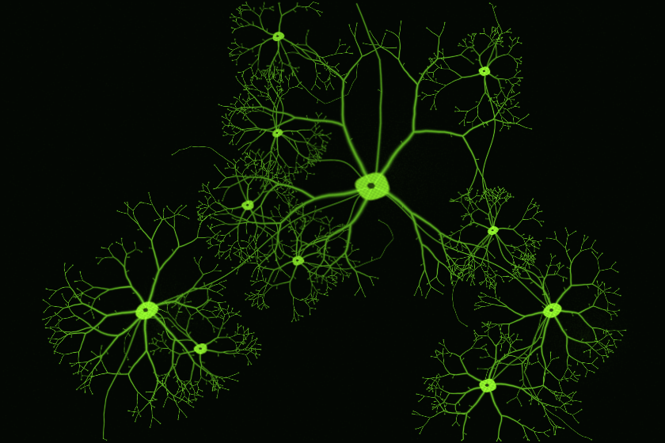

# Day 006 — Green Neural Touch

**100 Days of Eye Tracking · Made in our Eye5.js / Donut MIDI Workshop Editor**

Touch a neural landscape with your eyes. Gaze seeds bright green particle trails beneath a network of branching neurons. Looking across a connection temporarily parts it; moving away lets it reconnect. A blink launches a luminous green impulse through the tissue.

## Try it

Move the mouse to simulate gaze. Click to simulate a blink. No eye tracker or editor setup is required for this playground.

## Use our editor

1. Open [our Eye5.js / Donut MIDI Workshop Editor](https://sharkburger.github.io/donut-midi/library/editor.html).
2. Replace the editor contents with the complete [sketch.js](sketch.js) and press **Run**.
3. Use the mouse, or connect Pupil Labs Neon through the editor's input controls.
4. For live blinks, select **Capture open eyes · 2 s**, keep both eyes naturally open for two seconds, then close and reopen to pulse.

The editor supplies `p5`, `neon`, `MAT_URL` and current `NeonEffects` helpers. Do not paste duplicate connection declarations. Live blinks require fresh bilateral eyelid-aperture data. Missing samples are not blinks. Reconnect and recapture the eye reference when restarting the preview as needed.

| Input | Effect |
| --- | --- |
| Gaze / mouse movement | Seed living trails below the tissue, deform connections and open temporary gaps |
| Blink / mouse click / B | Launch a bright green impulse; mouse simulation is disabled in live mode |
| Move away | Healing begins after about 650 ms and reconnects over about 1.9 seconds |
| R | Regenerate the neuron arrangement |
| G | Show / hide the gaze halo |
| C | Switch between bright green and pale-green tissue |
| Q | Switch between high detail (840 px) and lighter rendering (560 px); regenerates the scene |
| 1 / 2 / 3 | Change particle sensing / movement presets |
| Space | Pause / resume the simulation |

## Morphology and interaction

Small irregular somas connect to recursive dendrites, long axons and terminal highlights. Branches narrow as their order increases. The neurons slowly expand and contract independently. The image is an artistic synthetic neural landscape, not empirical anatomical data or a physiological simulation.

Particle strokes use a separate trail field beneath the tissue. Agents sense, turn, move and deposit trails that diffuse and decay. A local lesion field temporarily hides foreground tissue and suppresses old trail memory before gradually restoring it. The scaffold's topology is not biologically rewired by this visual healing effect.

Live input retains a 100 ms buffer near eyelid closure and an approximately 180 ms reopening hold to suppress blink-related gaze jumps.

## Higher-quality rendering

The default simulation width increases from 560 to 840 pixels (2.25× as many simulation pixels). Tissue is sampled with bilinear interpolation during deformation, the output requests high-quality image scaling, and canvas density follows the display up to 2×. Interaction distances and movement rates scale with resolution.

Higher quality costs more processing time. Press **Q** for the lighter 560-pixel mode if needed. The demo uses the same sketch as the editor; it does not substitute a video or pre-rendered animation.

## Blink-freeze fix

Propagation costs are clamped to remain positive, preventing high-density regions from creating an endless shortest-path search. Work is processed in bounded slices (384 heap removals per animation frame), with at most two active waves and a 450 ms trigger cooldown. Blink bursts redistribute existing particles instead of increasing the steady-state count.

## Verification

Automated checks in a simulated p5 host cover morphology, taper, axons and dendrite branch order, particle strokes, timed healing, layer ordering, smooth lesion boundaries, autonomous size changes and blink propagation. The full-resolution propagation search is also checked separately. These checks do not replace live browser/device testing. Visual quality and frame rate depend on hardware; live Neon behavior requires device confirmation.

The preview is generated from the sketch's renderer without the Workshop chrome; it is not a physical-eye-tracker recording.

## References

- [nicoptere / physarum](https://github.com/nicoptere/physarum): particle-stream drawing interaction.
- [kai9987kai / Neuro-Forge](https://github.com/kai9987kai/Neuro-Forge): recursive neuronal morphology, taper and branch-order concepts.
- [Neuron — Gabrielle Kardzhilova](https://www.behance.net/gallery/138218251/Neuron): artistic reference for organic filament-like neurons.
- [Donut MIDI](https://github.com/sharkburger/donut-midi/tree/aoi-cognitive-voices): Eye5.js / Workshop host, Neon input helpers and experimental BlinkGate.
- [p5.js](https://p5js.org/): creative-coding runtime.

The neuron generator is independently written. Referenced artwork and third-party morphology code are not bundled. The mouse page reuses the repository's existing Day 004 runtime assets; see their [third-party notices](../004-blink-bloom/demo/THIRD_PARTY_NOTICES.md).
