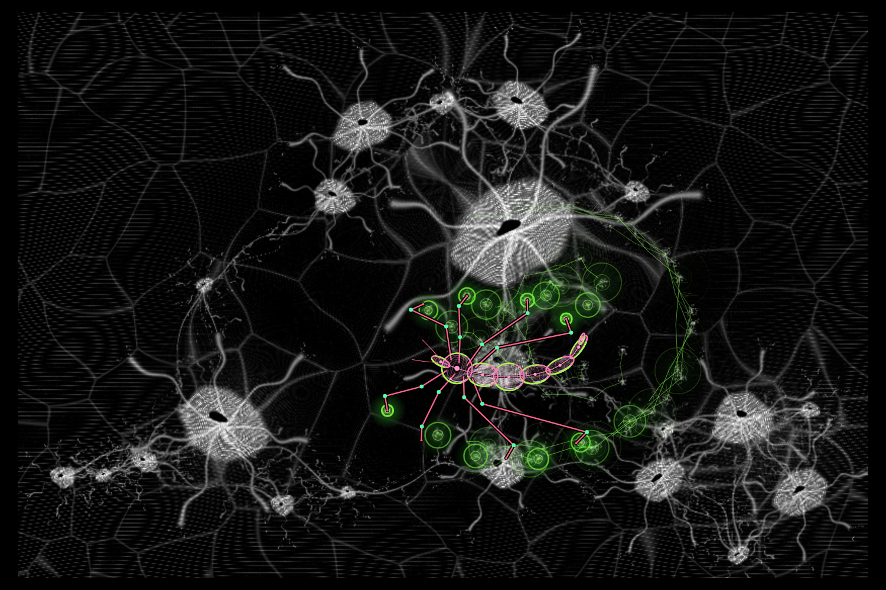

# Day 007 — Glass Crawler

**100 Days of Eye Tracking · Built in our Eye5.js / Donut MIDI Workshop Editor**

A glass-like pink creature follows your gaze across a breathing monochrome Physarum-inspired landscape. Overlapping rings, nested fine contours and a thin spine form its translucent body. Eight pink legs each have three line segments and two green bend joints.

## Try it

Move the mouse to guide the creature. When its head catches the target, green light travels along the legs and then launches a green network impulse. Clicking and blinking do not trigger the impulse. No eye tracker is required for the playground.

## Interaction

- Feet temporarily part and deform the tissue, with bright green expanding rings and soft contact light. The tissue gradually heals.
- Front legs gently explore while the creature rests near the target.
- Footsteps leave branching threads that grow briefly and fade.
- Reaching the target triggers once; the target must move away before another catch can trigger. The body keeps its pink colour during transmission.

## Run with eye tracking

1. Open [our Eye5.js / Donut MIDI Workshop Editor](https://sharkburger.github.io/donut-midi/library/editor.html).
2. Replace the editor contents with the complete [sketch.js](sketch.js) and press **Run**.
3. Connect Pupil Labs Neon through the editor's existing controls. Capture the two-second open-eye reference to enable eyelid-related gaze filtering; blinks are not pulse triggers in this work.

The editor supplies p5, neon, MAT_URL and NeonEffects. The standalone mouse demo shares the Day 004 runtime and marker assets.

| Control | Effect |
| --- | --- |
| Gaze / mouse movement | Guide the crawler |
| Catch the target | Send green light down the legs, then pulse the network |
| R | Regenerate the scene |
| G | Toggle the gaze halo |
| 1 / 2 / 3 | Change particle sensing and motion presets |
| Space | Pause / resume |

## Rendering and implementation

An 840-pixel-wide simulation, bilinear tissue sampling and high-quality image scaling reduce block-shaped deformation. Creature lines are drawn separately at display density up to 3×. Gradients and fine nested oval contours suggest glass without a 3D renderer. Higher detail requires more processing time.

The scaffold combines procedural colonies and filaments with a sensing / steering / deposit / diffusion particle field inspired by Physarum models. A constrained chain controls the body, planted-foot stepping drives locomotion, and each leg is drawn with two internal bend joints. This is stylized procedural motion, not a full articulated physics simulation.

Network propagation uses positive costs and bounded work per frame. Footprints, memory threads and active signals have bounded counts or lifetimes.

## Validation

Syntax and simulated-host checks cover pursuit, finite foot positions, segment spacing, contact damage, healing, delayed catch activation, resting exploration and bounded memory. The cover uses the published sketch's actual renderer in a canvas host; it is not a physical-eye-tracker recording. These checks do not establish live Neon accuracy or browser frame rate on every device.

## References

- [cyohei9907 / web-crawlers](https://github.com/cyohei9907/web-crawlers): planted feet and local surface responses.
- [maj0m / InverseKinematics](https://github.com/maj0m/InverseKinematics): procedural jointed locomotion.
- [nicoptere / physarum](https://github.com/nicoptere/physarum): living particle-stream interaction.
- [Jeff Jones's Physarum model](https://doi.org/10.1162/artl.2010.16.2.16202): multi-agent pattern formation.
- [Donut MIDI / Workshop](https://github.com/sharkburger/donut-midi/tree/aoi-cognitive-voices): editor and Neon helpers.

The creature drawing is independently implemented. Runtime licensing is documented in the [Day 004 third-party notices](../004-blink-bloom/demo/THIRD_PARTY_NOTICES.md).
