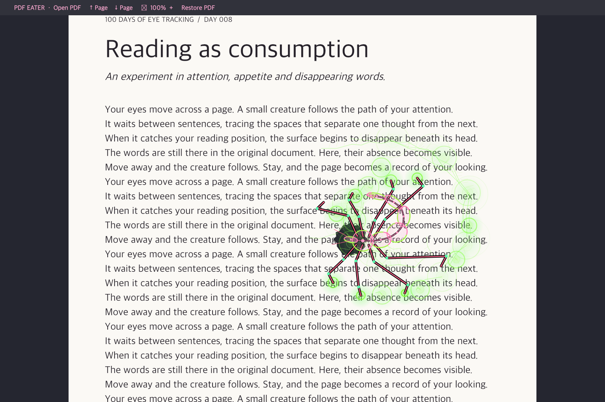

# Day 008 — PDF Eater

**100 Days of Eye Tracking · Built in our Eye5.js / Donut MIDI Workshop Editor**

What if your attention could consume what you read?

Upload a PDF, scroll through its pages, and let a pink glass crawler follow your gaze. When it catches your reading position, it stops and gradually eats an irregular hole into the page. Move your gaze away to stop feeding.

## Try it

1. Choose **Open PDF** and select a local document.
2. Scroll vertically using a wheel, trackpad or scrollbar; use the page buttons to move between pages.
3. Move the mouse to guide the crawler. Hold the target still so it catches up and begins eating.
4. Move away to stop. Use **Restore PDF** to clear the holes.

No eye tracker is required for the mouse playground. The creature overlay does not intercept scrolling. PDFs are displayed as page canvases, without a selectable text layer.

## Run with eye tracking

1. Open [our Eye5.js / Donut MIDI Workshop Editor](https://sharkburger.github.io/donut-midi/library/editor.html).
2. Paste the full [sketch.js](sketch.js), replacing the editor's previous code, and press **Run**.
3. Connect Pupil Labs Neon using the editor's usual controls, and select a PDF inside the sketch.
4. Capture an open-eye reference for eyelid-related gaze filtering. Blinks and clicks do not trigger feeding; catching the gaze target does.

Corner markers remain visible in live mode. Use the normal Neon surface-mapping setup for the reader viewport. The standalone page is a mouse simulation; live tracking requires the Workshop and its connector.

| Control | Effect |
| --- | --- |
| Gaze / mouse | Lead the creature |
| Catch the target | Begin eating at the creature's head |
| Move the target away | Stop eating |
| Wheel / trackpad / scrollbar | Read vertically |
| ↑ Page / ↓ Page | Previous / next page |
| − / + | Zoom |
| Restore PDF | Remove all holes |
| R | Reset the creature |
| G | Toggle the target halo |
| P | Pause / resume the creature |

## How it works

The creature retains Day 007's overlapping transparent pink rings, nested contours, green edges and eight pink legs with two internal joints per leg. Resting front legs explore gently, and foot contacts leave fading green traces.

PDF.js renders visible pages at display density up to 2×. Distant canvases are released and recreated as needed. Feeding removes pixels from the rendered page with an irregular growing mask. Masks are stored per page in normalized coordinates and reapplied after zoom or re-rendering. Page contents are visually erased, including text and images; the PDF's underlying text and original bytes are unchanged. There is no modified-PDF export.

Moving the gaze away stops feeding; scrolling also clears the current feeding anchor. Holes persist during the reading session, but reloading or opening another file clears them. The original PDF is never overwritten or uploaded to an application server. Standard font / character-map resources may be requested from jsDelivr when required by a document.

PDF.js and its worker handler are bundled directly. The handler is registered on the current page to work in sandboxed editor frames without dynamic module imports or blob worker loads. Large PDFs may therefore briefly compete with animation while pages render.

## Validation and preview

Syntax checks and a browser-like sandbox test verify that the bundled engine opens a two-page PDF without Worker or blob requests. Canvas tests cover progressive holes, preserved surrounding pixels, stopping on gaze departure, and reapplying masks at 2× zoom. Creature pursuit and motion were checked in a simulated host. Actual browser and live-device performance still depend on the environment.

The cover combines an original sample reading layout with the actual creature and hole-mask drawing code; it is an illustrative preview, not an eye-tracker recording or an uploaded user's document.

## References and licenses

- [Day 007 — Glass Crawler](../007-glass-crawler/): creature design and procedural locomotion.
- [cyohei9907 / web-crawlers](https://github.com/cyohei9907/web-crawlers): creatures reacting to reading surfaces.
- [maj0m / InverseKinematics](https://github.com/maj0m/InverseKinematics): articulated procedural movement.
- [PDF.js](https://mozilla.github.io/pdf.js/): PDF rendering; Apache-2.0. Bundled version 3.11.174 includes its copyright notices.
- [Eye5.js / Donut MIDI Workshop](https://github.com/sharkburger/donut-midi/tree/aoi-cognitive-voices): editor and Neon input.

See [third-party notices](demo/THIRD_PARTY_NOTICES.md).
