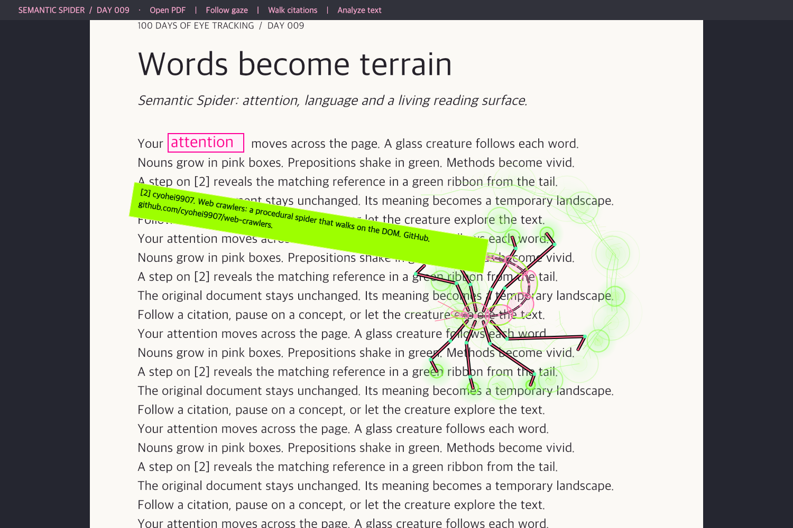

# Day 009 — Semantic Spider

**100 Days of Eye Tracking · Built in our Eye5.js / Donut MIDI Workshop Editor**

A glass crawler turns reading into a physical encounter with words. Its eight articulated legs land on a PDF's word layer. Each contact responds to what the word means—or what role it plays in a sentence.

[](https://dolbywu.github.io/100-days-of-eye-tracking/days/009-semantic-spider/demo/)

## Try it with a mouse

[](https://dolbywu.github.io/100-days-of-eye-tracking/days/009-semantic-spider/demo/)

Open a text-based PDF and move the mouse to guide the crawler. Scroll vertically and zoom while reading. A basic local word classifier and numbered-reference index work without an API key. **Find references locally** scans for citation patterns; the walking-mode selector can tour references or technical terms.

Scanned image-only PDFs require OCR first. PDF.js creates the word layer, and some PDF encodings or unusual text order can affect alignment and classification.

## What happens under its feet

| Word or content | Reaction |
| --- | --- |
| Ordinary words | Brief subtle pink outline / colour response |
| Nouns | Saturated pink box and enlargement |
| Prepositions | Green highlight and shake |
| Technical terms, algorithms, methodologies, key concepts | Strong fluorescent-pink enlargement, jitter and echoes |
| Numeric citations such as [2] | Show the corresponding bibliography entry on a long bright-green rectangular ribbon connected to the tail |

Citations take priority over technical and grammatical effects. Local grammar uses a small vocabulary and suffix rules; OpenAI classification uses context. Neither is a guarantee of linguistic correctness.

Groups such as **[17,35,41,45]** contain four independent references. Ranges such as **[17–19]** and split bracket/number text fragments are handled. A grouped ribbon cycles through the resolved entries every six seconds. Missing entries appear in the status line, not as invented reference text in the ribbon.

The bibliography index scans backwards for a References heading (up to 60 pages), with support for common two-column layouts and multi-line entries. If needed, enter an explicit **Reference pages** range and click **Reindex reference pages locally**. **Preview tail** shows a resolved entry if available, or an explicitly labelled demonstration otherwise.

## OpenAI analysis — run the local relay

GitHub Pages hosts the browser artwork; it does not run a server or hold an API key. For OpenAI analysis, download or clone the repository and run from this folder:

```sh
node semantic-reader-server.cjs
```

Then open **http://127.0.0.1:8791**. On macOS, the included `start-semantic-reader.command` offers the same launch flow. Node.js is required; no package installation is needed. Keep the relay and `demo/index.html` in this folder structure.

1. Open a PDF in the local reader.
2. Paste your own OpenAI API key into the password field. The key is not saved to disk, browser storage or application logs.
3. Choose a model you can access; the default is `gpt-4.1-mini`.
4. Set reading page numbers (blank means current page) and bibliography pages (blank defaults to the last three pages).
5. Click **Analyze text + resolve references**. Only this action sends selected reading and reference text to OpenAI through the local relay. Limits are 2,400 reading words and 4,800 reference words per request; API usage is billed to your account.
6. Choose a walking mode or continue guiding with your gaze / mouse.

Responses use structured JSON and `store:false`; this is not a claim of zero provider retention. Returned word IDs are filtered against the document. Reference results must identify a contiguous source span with the matching bibliography number. Local reference extraction also supplements the mapping. This is an in-document lookup, not external verification of a paper's existence or claims.

**Clear key** empties the field. **Cancel** aborts the local request; a provider may already have begun processing it. The relay binds to `127.0.0.1` only, uses a fixed OpenAI endpoint and restricts browser origins. Prefer the localhost reader for AI analysis; browsers can block requests from a hosted HTTPS page to localhost.

## Use our eye-tracking editor

Paste the entire [sketch.js](sketch.js) into [our Eye5.js / Donut MIDI Workshop Editor](https://sharkburger.github.io/donut-midi/library/editor.html), replace the previous sketch and press **Run**. Connect Pupil Labs Neon using the editor's normal connector and surface mapping. Capture an open-eye reference for eyelid-related gaze filtering. The same local relay is needed for API analysis.

The page's mouse simulation does not require a tracker. **Eat instead of word effects** restores Day 008's optional page-eating mode. The original PDF bytes are never modified. R resets the creature, G toggles the target halo, and P pauses motion.

## Stability and validation

Word positions and citation contexts are cached. Bibliography indexing yields between pages and does not run from the foot-contact path. Only one tail ribbon is active; text is laid out and rasterized to a reusable bitmap, with old bitmaps released. A draw-error guard reports failures instead of allowing an exception to stop the animation loop.

Checks cover compound citations, split brackets in two-column bibliography text, exact numbered lookup, grammar-specific effects, ordinary-word reactions, route progression, input validation and mocked structured API responses. A stress check exercises 500 sequential references over 2,500 ribbon frames with at most one live bitmap. No real API call was made as part of publication. These simulated checks do not establish performance for every PDF, browser or live tracker.

The cover is an illustrative composition using original sample text and the actual creature/ribbon renderer. It is not a screenshot of a user's PDF or an eye-tracker recording.

## References and licenses

- [cyohei9907 / web-crawlers](https://github.com/cyohei9907/web-crawlers): word-based procedural walking and transient CSS mutations.
- [maj0m / InverseKinematics](https://github.com/maj0m/InverseKinematics): articulated procedural locomotion.
- [Day 007](../007-glass-crawler/) and [Day 008](../008-pdf-eater/): creature and local PDF-reader foundations.
- [OpenAI Responses API](https://developers.openai.com/api/reference/resources/responses/methods/create) and [Structured Outputs](https://developers.openai.com/api/docs/guides/structured-outputs): context-based word classification and source-linked reference mapping.
- [PDF.js](https://mozilla.github.io/pdf.js/) and [p5.js](https://p5js.org/): document and artwork rendering.

The interaction code is independently implemented. Bundled runtime notices are in [THIRD_PARTY_NOTICES.md](demo/THIRD_PARTY_NOTICES.md).
