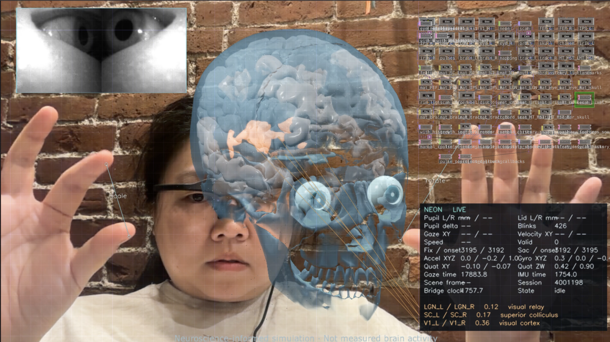

# Day 017 · The Seeing Brain

[](https://youtu.be/_Fubeu3Un7g)

[Watch the Day 016 video on YouTube](https://youtu.be/_Fubeu3Un7g)

Open **[The-Seeing-Brain.toe](The-Seeing-Brain.toe)** in TouchDesigner and view `/project1/seeing_brain/out_scan`. The saved project starts with a synthetic demonstration. If you obtained only the source files, prepare the meshes first. Keep the project beside its assets folder.

[Demo preview](media/demo.mp4) · [Oblique](media/oblique.png) · [Front](media/front.png) · [Lateral](media/lateral.png) · [Superior](media/superior.png)

### Try the controls

Select the `seeing_brain` component and open its **Seeing Brain** parameter page. Azimuth and Elevation orbit the shared anatomical origin. Skull, Brain, Exposure and Bloom control the three-pass composite. Fixation, Saccade and Blink trigger short illustrative events. **Region gain** scales the response per structure. **Manual emission** lets you illuminate one region even without an event. Set Mock off for OSC. Reduced slows pathway motion and lowers activation brightness. Reset clears the region envelopes and projected trail history. Ongoing input then repopulates them.

Growth enables a 160 × 90 projected agent field within the rendered cortical silhouette. Agents sense the trail and regional light, turn, move and deposit. Sensor, Distance, Deposit, Diffusion, Retention and Attraction adjust the field. Changing view resets screen-space history. Record starts a Movie File Out capture of the composite, with the simulation disclosure included. Switch Record off to finalize the uniquely named movie beside the project.

### Connect Neon or replay a recording

The existing TD-Neon app or the repository's Day 012 bridge sends OSC/UDP float channels. Use one bridge sender. Match its destination port to the project's Port control (default **9000**). The companion device API port is separate. Use the same LAN for a physical device.

From the repository root, the following commands are alternatives. Switch Mock off before testing the bridge.

```sh
python3 days/012-gaze-fluid/neon_bridge.py --port 9000 demo
python3 days/012-gaze-fluid/neon_bridge.py --port 9000 replay /path/to/bridge-capture.csv --loop
python3 days/012-gaze-fluid/neon_bridge.py --port 9000 live --device YOUR_COMPANION_IP
```

The first two use the standard library. For live acquisition install the existing [bridge requirements](../012-gaze-fluid/requirements-live.txt) in a Python virtual environment. The installed macOS bridge environment reported pupil-labs-realtime-api **1.9.0**. The local TD-Neon app's bridge sent valid gaze on port 9000 in the hardware test. The application also ran with the repository bridge's synthetic OSC stream.

### Reproduce the build

Tested with Blender **5.0.1** and TouchDesigner **2025.33230** on macOS. Blender supplies bpy and NumPy. The TD runtime supplies NumPy and OpenCV; cv2 is used for the optional trail field. Python 3's standard library suffices for the signal tests. FFmpeg was used only to convert the short validation recording to MP4.

1. From this day directory, prepare the assets. The script downloads the pinned 83 MiB archive, verifies SHA-256, retains the original Blender scene, and exports the 24 aligned OBJ groups. The archive, original scene and generated meshes are locally retained and excluded from Git.
2. Open a **new** TouchDesigner project. In Textport run the snippet below using the absolute day directory. Save the resulting project beside the assets. The builder refuses to overwrite an existing component of the same name.
3. For a fresh checkout, opening the supplied TOE after step 1 also works. Use the controls above to validate front, lateral and superior views.

```sh
"/Applications/Blender.app/Contents/MacOS/Blender" -b --factory-startup --disable-autoexec --python-exit-code 1 --python scripts/prepare_assets.py
python3 -m unittest discover -s tests -v
```

```python
from pathlib import Path
folder = Path('/absolute/path/to/017-seeing-brain')
exec((folder/'touchdesigner/build_network.py').read_text())
scene = build(folder)
project.save(str(folder/'The-Seeing-Brain.toe'))
scene.op('out_scan').openViewer()
```

On Windows use the Blender executable path for that installation. The TD-Neon macOS app is optional; the Python bridge is the portable entry point. Windows acquisition, codecs and rendering have not been tested.

### Rendering and validation

Three GPU geometry passes render the skull, cortical tissue, and activity/eyes independently. Their composite approximates translucency using the visible surface of each pass. The orbital camera exposes true 3D geometry. The amber spheres are GPU instances positioned in batches along schematic pathways. Both eyes use the same combined gaze, with bounded artistic rotations about their own centers.

The rendered disclosure reads **Neuroscience-informed simulation · Not measured brain activity**. See [asset provenance](assets/manifest.json), [attributions and scope](assets/README.md), and [visual mapping and validation](docs/validation.md).

### Hand controls on macOS

The mirrored live Mac camera fills the background behind the scan and fingertip labels. The unmirrored camera input also supplies frames to Apple Vision. Movie export includes the camera portrait. Hold the left thumb and index finger in view and spread them to enlarge the entire anatomy. Closing the span reduces it. The right thumb–index span controls rotation about the anatomical scene's vertical Y axis (−115° to +115°). Two fingertip segments labeled **scale** and **rotate** appear on the scan while tracked. Distances are relative to the visible palm. Losing a hand hides its segment and holds the current transform. During rotation, screen-space particles inherit color from the rendered anatomy and fade over roughly 0.3–0.75 seconds. Allow camera access for TouchDesigner. The helper uses Vision handedness on the unmirrored capture. To rebuild it with Apple's command-line developer tools, run `swiftc -O scripts/hand_pose.swift -o scripts/hand-pose` from this directory. The camera stays independent of the Neon OSC connection.

### Research reference

The visual mapping was informed by *Brain-wide activation and deactivation maps during smooth and saccadic tracking in humans*, Cerebral Cortex, volume 35, issue 8 (2025), bhaf242. The project uses a qualitative artistic mapping from eye events to regional light.

[Read the paper](https://academic.oup.com/cercor/article/35/8/bhaf242/8250586)
